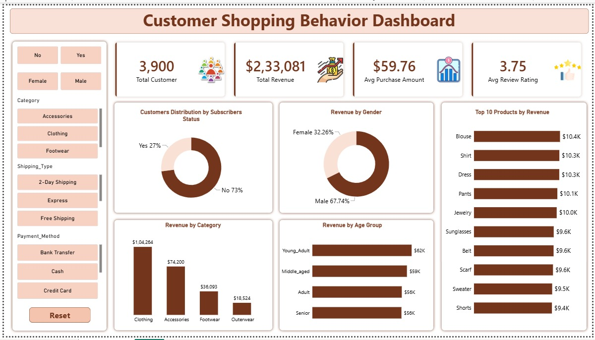

🛍️ Customer Shopping Behavior Analysis

📌 Project Overview

Customer Shopping Behavior Analysis is an end-to-end data analytics project focused on understanding customer purchasing patterns, spending behavior, product preferences, and revenue performance.

The project uses Python, SQL, Excel, and Power BI to transform raw customer shopping data into meaningful business insights and interactive visualizations.

🎯 Business Objectives

- Analyze customer purchasing behavior and spending patterns.
- Understand revenue contribution across product categories.
- Identify customer preferences based on gender and age groups.
- Analyze subscription status and shipping preferences.
- Identify top-performing products by revenue.
- Understand customer payment methods and purchase trends.

🛠️ Tools & Technologies

Tool| Purpose
Python| Data cleaning and exploratory data analysis
Pandas| Data manipulation and analysis
SQL| Database querying and business analysis
PostgreSQL| Database management
Excel| Data exploration and analysis
Power BI| Interactive dashboard development
Jupyter Notebook| Python analysis environment

📂 Project Structure

Customer-Shopping-Behavior-Analysis/
│
├── Customer_Shopping_Behavior.ipynb
├── customer_behavior.sql
├── customer_behavior_dashboard.pbix
├── customer_shopping_behavior.csv
├── Customer_Shopping_Behavior_Analysis.pdf
├── Project.pdf
├── customer_shopping_behavior_dashboard.png
└── README.md

📊 Dashboard Highlights

The Power BI dashboard provides an interactive overview of customer shopping behavior.

Key Performance Indicators (KPIs)

- Total Customers: 3,900
- Total Revenue: $233,081
- Average Purchase Amount: $59.76
- Average Review Rating: 3.75

Dashboard Analysis

1. Customer Distribution by Subscription Status

- Analyzes subscribed and non-subscribed customers.
- Identifies subscription patterns.

2. Revenue by Gender

- Compares revenue contribution from male and female customers.

3. Top 10 Products by Revenue

- Identifies the highest revenue-generating products.

4. Revenue by Category

- Compares revenue across Clothing, Accessories, Footwear, and Outerwear.

5. Revenue by Age Group

- Analyzes purchasing contribution across different customer age groups.

Interactive Filters

The dashboard includes slicers for:

- Gender
- Subscription Status
- Product Category
- Shipping Type
- Payment Method

🔍 Key Business Insights

- Clothing is the highest revenue-generating category.
- Male customers contribute approximately 67.74% of revenue.
- Non-subscribed customers represent approximately 73% of the customer base.
- Young Adult customers contribute the highest revenue among the displayed age groups.
- Blouse and Shirt are among the top revenue-generating products.

🐍 Python Analysis

Python was used for:

- Data loading and inspection.
- Data cleaning and preprocessing.
- Handling missing values.
- Exploratory Data Analysis (EDA).
- Identifying customer purchasing patterns.
- Analyzing revenue and customer segments.

🗄️ SQL Analysis

SQL was used to perform:

- Data aggregation and summarization.
- GROUP BY and HAVING operations.
- Joins and subqueries.
- Customer segmentation.
- Revenue analysis.
- Ranking and window function analysis.

📈 Excel Analysis

Excel was used for:

- Data exploration.
- Data cleaning.
- Summary analysis.
- Aggregation and reporting.

💡 Business Value

This analysis helps businesses understand their customers, identify profitable product categories, evaluate purchasing patterns, and make data-driven decisions to improve customer engagement and revenue performance.

👨‍💻 Author

Prathvi Naik

BCA Graduate | Aspiring Data Analyst

Technical Skills: Python | SQL | Excel | Power BI | PostgreSQL | Git & GitHub

LinkedIn: "Connect with me" (https://www.linkedin.com/in/prathvi-naik-967377397/)

---

⭐ If you find this project useful, feel free to explore the repository and share your feedback.

Thank you for visiting!
